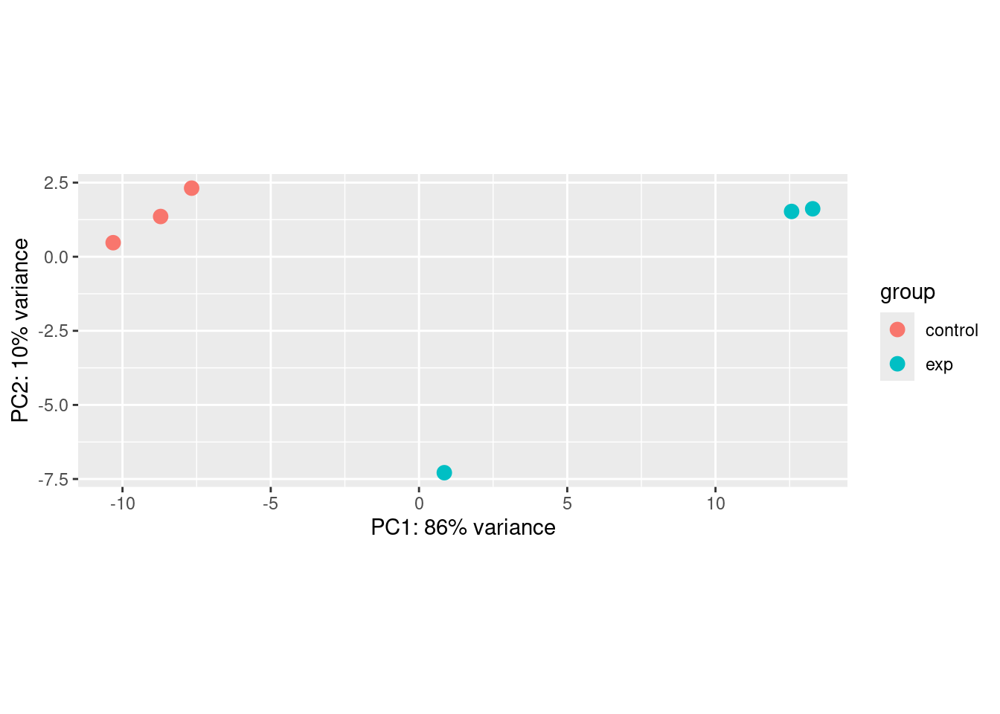
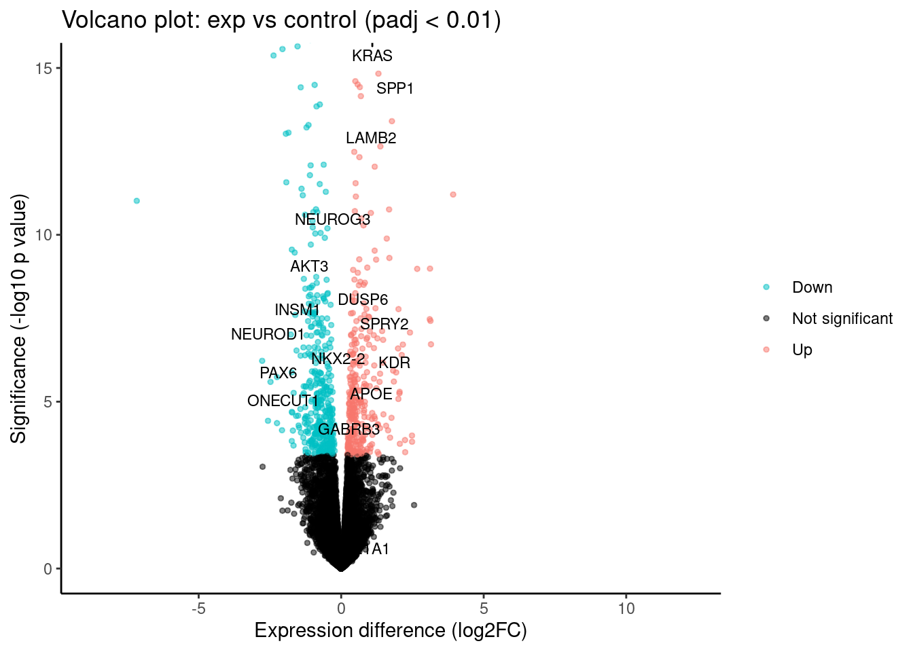
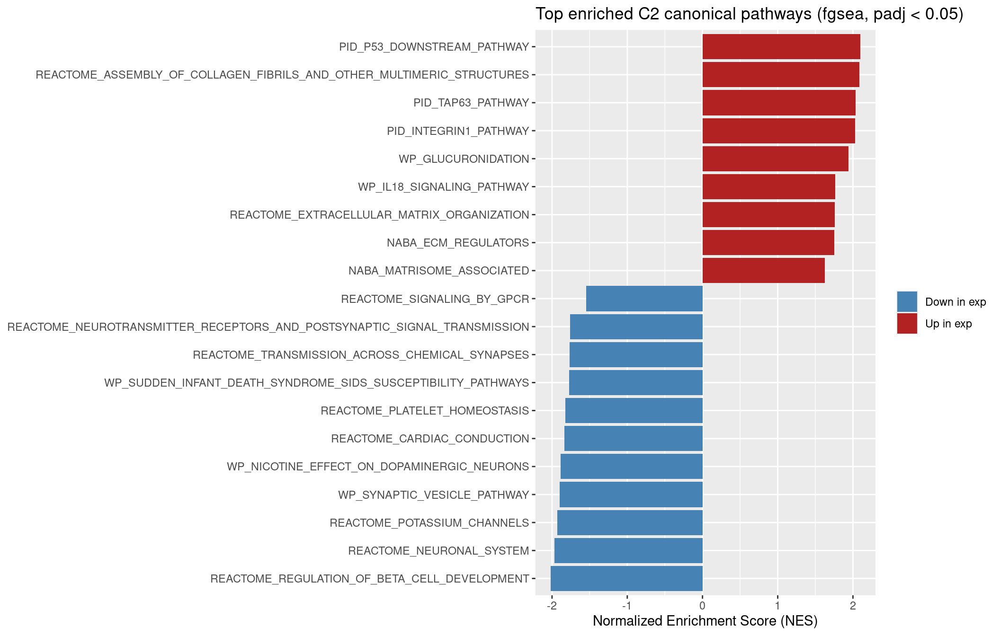

# RNA-seq Analysis Pipeline

A Nextflow pipeline for paired-end bulk RNA-seq, from raw FASTQ files to a gene-level counts matrix, followed by differential expression and pathway enrichment analysis in R. The pipeline was applied to six samples (3 control, 3 experimental) and the results were compared with a published study of TYK2 knockout in stem cell-derived pancreatic islets.

Built for BF528 (Applications in Translational Bioinformatics) at Boston University and run on the BU Shared Computing Cluster.

## Pipeline


| Step | Tool | Notes |
|------|------|-------|
| Read QC | FastQC v0.12.1 | Run on every R1 and R2 file |
| Genome index | STAR v2.7.11b | GRCh38 primary assembly with GENCODE v45 annotation |
| Alignment | STAR v2.7.11b | Unsorted BAM output |
| Quantification | VERSE v0.1.5 | Gene-level exon counts |
| Counts matrix | Python (pandas) | Custom script in `bin/concat_cts.py` |
| Gene ID mapping | Python (Biopython container) | Custom script in `bin/parse_gtf.py` |
| QC summary | MultiQC v1.33 | Combines FastQC and STAR alignment logs |
| Downstream analysis | R: DESeq2, fgsea, msigdbr, pheatmap | `rnaseq-report.Rmd` |

Every process runs in its own container (Docker images executed with Singularity) and includes a `stub` block, so the full workflow can be tested on empty files before running on real data.

## Results

**Quality control.** Samples had 84.5 to 118.9 million read pairs each, and 95.8% to 97.8% of reads aligned to GRCh38. Adapter content was negligible, so no trimming was needed.

**Filtering.** Genes were kept if they had at least 10 counts in at least 3 samples, which reduced the matrix from 63,241 to 20,579 genes.

**Sample structure.** In the PCA of variance-stabilized counts, PC1 explained 86% of the variance and separated samples by condition. One experimental replicate sat between the two groups and was kept, since dropping it would leave only two experimental replicates.

**Differential expression.** DESeq2 found 1,254 genes significant at padj < 0.05 (572 up, 682 down in the experimental condition).

**Enrichment.** DAVID and fgsea (MSigDB C2 canonical pathways) agreed on the main themes:
- Upregulated: extracellular matrix organization and collagen formation (DAVID extracellular matrix: 5.0-fold, Benjamini 1.7e-23)
- Downregulated: neuronal and synaptic signaling (DAVID synapse: 3.0-fold, Benjamini 3.2e-13)

**Comparison with the published study.** At the paper's threshold of padj < 0.01, this pipeline found 332 upregulated and 403 downregulated genes, compared with 319 and 412 reported by the authors. Both analyses found upregulation of extracellular matrix pathways. The paper's beta-cell development signal was weaker here, likely because of differences in read trimming, counting (featureCounts vs. VERSE), gene filtering, FDR method, and pathway databases. These are discussed in the report.

### Figures

**Sample PCA.** PC1 (86% of variance) separates control and experimental samples.



**Volcano plot** at the paper's threshold (padj < 0.01), with the genes highlighted in the original Figure 3C labeled.



**Top enriched pathways** from fgsea with MSigDB C2 canonical pathways (padj < 0.05).



## Repository layout

```
main.nf                 Workflow definition and input channels
nextflow.config         Paths to reference files and samplesheets, cluster profiles
modules/                One Nextflow process per tool
bin/                    Custom Python scripts (parse_gtf.py, concat_cts.py)
rnaseq-report.Rmd       QC, filtering, DESeq2, enrichment, and paper comparison
specifications.md       Pipeline design and validation plan
full_samplesheet.csv    Sample names and FASTQ paths (subset_samplesheet.csv for testing)
figures/                Plots generated by knitting the report
enrichment/             DAVID results and the gene lists submitted to DAVID
reports/                Nextflow execution reports
```

## Running it

Requires Nextflow and Singularity. Raw data and reference files are not included in this repository; set their paths in `nextflow.config`.

```bash
# Test the workflow logic with empty placeholder files
nextflow run main.nf -stub

# Full run on an SGE cluster
nextflow run main.nf -profile singularity,cluster -with-report
```

Then knit `rnaseq-report.Rmd` in R (v4.4) to reproduce the downstream analysis.

## Reference

Chandra V, Ibrahim H, Halliez C, et al. The type 1 diabetes gene TYK2 regulates β-cell development and its responses to interferon-α. *Nature Communications*. 2022;13:6363. [doi:10.1038/s41467-022-34069-z](https://doi.org/10.1038/s41467-022-34069-z)