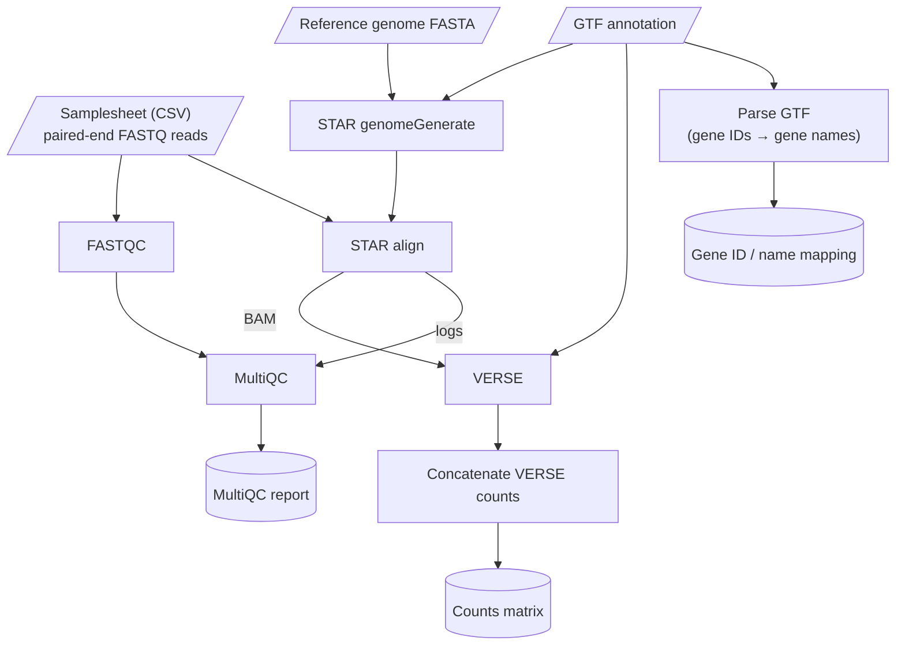

> **Note:** Sections marked **Instructions:** are scaffolding to guide you. Delete every
> instruction block (and the Example Table) once you've filled in the section, so the final
> document contains only your specifications.

# Provided Diagram

# Objective

A nextflow pipeline that takes paired-end short reads from RNA-seq samples and
generates a counts matrix for downstream differential expression analysis. This
will include quality control of the raw reads using FastQC, followed by
generation of a genome index from the reference genome and GTF annotation
using STAR. The paired-end reads will then be aligned to the reference genome
using STAR, and the resulting alignments will be used by VERSE in conjunction
with the GTF annotation to quantify the number of reads mapped to each gene for
every sample. The per-sample counts will be concatenated into a single counts
matrix, and the GTF annotation will be parsed to produce a mapping of gene IDs
to gene names. The quality of the sequencing reads and the success of the
alignments will be assessed by aggregating the FastQC reports and STAR
alignment logs into a single report using MultiQC.

# Inputs

- Samplesheet (CSV: `name`, `r1`, `r2`)
- Six paired-end RNA-seq samples: three control and three experimental
- GRCh38 primary assembly reference genome FASTA
- GENCODE v45 primary assembly GTF annotation

# Outputs

Per Sample:
- FastQC reports for the R1 and R2 reads
- STAR alignment (BAM)
- STAR alignment log
- VERSE gene-level counts

Per pipeline run:
- STAR genome index
- MultiQC report of FastQC and STAR alignment results
- Counts matrix of all samples
- Gene ID to gene name mapping

# Pipeline Steps

## Pipeline Table

| Step | Input type | Depends on |
|---|---|---|
| FASTQC *(sample)* | Paired-end FASTQ files (R1 and R2) | None |
| STAR_INDEX | Reference genome FASTA and GTF annotation | None |
| STAR_ALIGN *(sample)* | Paired-end FASTQ files and STAR genome index | STAR_INDEX |
| VERSE *(sample)* | STAR alignment BAM and GTF annotation | STAR_ALIGN |
| CONCAT_COUNTS | Per-sample VERSE count files | VERSE |
| PARSE_GTF | GTF annotation | None |
| MULTIQC | FastQC reports and STAR alignment logs | FASTQC, STAR_ALIGN |

# Development Workflow

Every process defines a `stub:` run that produces placeholder output files. All of
the stub runs should use the name from the CSV to identify outputs by their species
of origin.

# Environment and Reproducibility

The pipeline uses Docker containers from the BU BF528 pipeline containers repository, executed through Singularity on the BU Shared Computing Cluster. Each tool is assigned its corresponding container image in the Nextflow process definition.

| Tool | Container image | Version |
|---|---|---|
| FastQC | `ghcr.io/bu-cds-bf528/fastqc:latest` | 0.12.1 |
| STAR | `ghcr.io/bu-cds-bf528/star:latest` | 2.7.11b |
| VERSE | `ghcr.io/bu-cds-bf528/verse:latest` | 0.1.5 |
| MultiQC | `ghcr.io/bu-cds-bf528/multiqc:latest` | 1.33 |
| Python / pandas | `ghcr.io/bu-cds-bf528/pandas:latest` | pandas 3.0.1 |
| Python / Biopython | `ghcr.io/bu-cds-bf528/biopython:latest` | Biopython 1.86 |

Nextflow v26.04.6 was used to execute the workflow. The container images use the `latest` tag rather than immutable version-specific tags, so the image tags do not independently guarantee that the exact same container build will be retrieved in a future run. The software versions listed above are the versions documented in the analysis report.

# Resource Requirements

| CPUs | RAM | Label | Process |
|---|---|---|---|
| 1 | - | process_single | - |
| 4 | - | process_low | CONCAT_COUNTS, FASTQC, PARSE_GTF, MULTIQC |
| 8 | - | process_medium | VERSE |
| 16 | - | process_high | STAR_INDEX, STAR_ALIGN |

# Success Criteria

**Stub-run milestone:**
- The pipeline completes successfully using `-stub-run`.
- Every process produces its expected placeholder output.
- Sample-specific outputs are named using the corresponding sample name from the CSV.
- All process dependencies and output channels are connected correctly.
- The final aggregation processes also complete using their stub implementations.

**Full-run milestone:**
- The pipeline completes successfully for all six RNA-seq samples.
- FastQC reports are generated for both read files from every sample.
- STAR produces BAM files and alignment logs for all six samples.
- VERSE generates gene-level counts for every sample.
- The per-sample count files are combined into a counts matrix containing all six samples.
- The GTF parsing process produces a gene ID to gene name mapping.
- The MultiQC report includes FastQC and STAR alignment results for all six samples.

# Out of Scope
Differential expression analysis, sample-level PCA, functional enrichment analysis, and biological interpretation are performed separately in the accompanying R Markdown report using DESeq2, DAVID, and fgsea. These analyses are not included as processes in the Nextflow pipeline. 

# Validation Table

| Step | Parameter justification | Confidence | Validation |
|---|---|---|---|
| Sequencing quality control | Default FastQC parameters were used to assess per-base quality, sequence content, duplication, and adapter contamination. No trimming was performed because adapter contamination was minimal. | High | FastQC reports were generated for all 12 FASTQ files. Overrepresented sequences accounted for less than 1% of reads in every file, and adapter contamination was minimal. |
| Genome indexing | STAR v2.7.11b was used with `--runMode genomeGenerate` and `--sjdbGTFfile` to incorporate the GENCODE v45 annotation into the GRCh38 genome index. Other parameters were left at their defaults. | High | STAR successfully generated the genome index, which was subsequently used to align all six samples. |
| Alignment | STAR v2.7.11b was used with default alignment parameters. `--readFilesCommand zcat` was used to decompress the paired-end FASTQ files, and `--outSAMtype BAM Unsorted` generated BAM output. | High | Overall alignment rates ranged from 95.8% to 97.8%. Uniquely mapped reads ranged from 91.9% to 94.0%, indicating consistently high alignment across samples. |
| Quantification | VERSE v0.1.5 was used with the `-S` option to accommodate paired-end alignments that were not sorted by read name, along with the GENCODE v45 GTF annotation. Other parameters were left at their defaults. | Medium | Gene-level count files were generated for all six samples. The resulting counts were used to create the combined gene-by-sample matrix. |
| Counts concatenation | A custom Python script using pandas v3.0.1 was used to combine the per-sample VERSE count files into one gene-by-sample matrix. | Medium | The combined matrix contained counts for all six samples and was successfully used for downstream analysis. |
| GTF parsing | A custom Python script using Biopython v1.86 was used to extract gene IDs and corresponding gene names from gene features in the GENCODE v45 GTF annotation. | Medium | The resulting mapping file was successfully used to associate gene IDs in the counts matrix with gene names during downstream analysis. |
| QC aggregation and reporting | MultiQC v1.33 was run with default parameters to combine FastQC reports and STAR `Log.final.out` alignment statistics. | High | The MultiQC report contained sequencing quality and alignment information for all six samples. |
| Differential expression | DESeq2 v1.46.0 was used with the design formula `~ condition` and a contrast of experimental versus control. Genes were filtered to retain those with at least 10 counts in at least three samples. The Wald test and Benjamini-Hochberg adjustment were used, with an adjusted p-value cutoff of 0.05. | High | The analysis identified 1,254 significantly differentially expressed genes: 572 upregulated and 682 downregulated in the experimental condition. |

