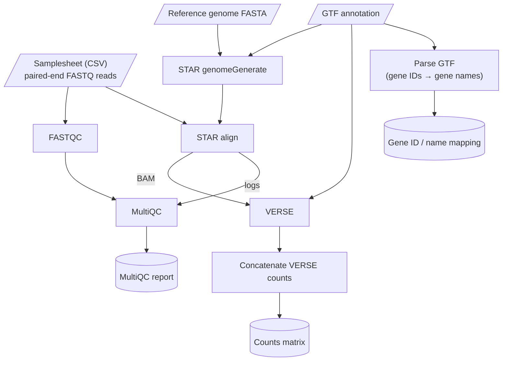

> **Note:** Sections marked **Instructions:** are scaffolding to guide you. Delete every
> instruction block (and the Example Table) once you've filled in the section, so the final
> document contains only your specifications.

# Provided Diagram

# Objective

A nextflow pipeline that takes paired-end short reads from RNA-seq samples and
generates a counts matrix for downstream differential expression analysis. This
will include quality control of the raw reads using FastQC, followed by
generation of a genome index from the reference genome and GTF annotation
using STAR. The paired-end reads will then be aligned to the reference genome
using STAR, and the resulting alignments will be used by VERSE in conjunction
with the GTF annotation to quantify the number of reads mapped to each gene for
every sample. The per-sample counts will be concatenated into a single counts
matrix, and the GTF annotation will be parsed to produce a mapping of gene IDs
to gene names. The quality of the sequencing reads and the success of the
alignments will be assessed by aggregating the FastQC reports and STAR
alignment logs into a single report using MultiQC.

# Inputs

Samplesheet (CSV: name, r1, r2)
3 control samples, 3 experimental samples

Reference genome FASTA and GTF annotation

# Outputs

Per Sample:
- FastQC reports for the R1 and R2 reads
- STAR alignment (BAM)
- STAR alignment log
- VERSE gene-level counts

Per pipeline run:
- STAR genome index
- MultiQC report of FastQC and STAR alignment results
- Counts matrix of all samples
- Gene ID to gene name mapping

# Pipeline Steps

> **Instructions:** Fill in one row per process in the pipeline. Derive the step list from the
> Objective and Outputs sections above. "Depends on" should name the upstream step(s) whose output
> this step consumes (used for wiring channels). Try to list only the minimum set of files needed
> for the next step. 
>
> The Example Table below is a simple worked example (not from this pipeline) showing the expected
> format: a process that downloads a genome, followed by a process that runs a script on it.
> **Delete the Example Table and this instruction block before you submit.**

## Example Table

| Step | Input type | Depends on *(sample)* |
|---|---|---|
| Download genome *(sample)* | Accession ID | - |
| Run script on genome *(sample)* | Genome FASTA | Download genome |

## Pipeline Table

| Step | Input type | Depends on |
|---|---|---|
|  |  |  |
|  |  |  |
|  |  |  |
|  |  |  |
|  |  |  |
|  |  |  |
|  |  |  |
|  |  |  |
|  |  |  |
|  |  |  |

# Development Workflow

Every process defines a `stub:` run that produces placeholder output files. All of
the stub runs should use the name from the CSV to identify outputs by their species
of origin.

# Environment and Reproducibility
For this project, we are switching over to using Docker containers through Singularity.

> **Instructions:** Look at the [Pipeline Containers](https://github.com/bu-cds-bf528/pipeline_containers)
> repository and fill in which versions of tools were used in your pipeline.
>
> *Delete this instruction block once you've completed this section.*

| Tool | Env file | Version |
|---|---|---|
|  |  |  |
|  |  |  |
|  |  |  |
|  |  |  |
|  |  |  |
|  |  |  |

# Resource Requirements

| CPUs | RAM | Label | Process |
|---|---|---|---|
|  |  |  |  |
|  |  |  |  |
|  |  |  |  |
|  |  |  |  |

# Success Criteria

The stub-run correctly produces named placeholder outputs for each row in the original CSV.

# Out of Scope

# Validation Table

For differential expression, include the model design used in DESeq2 in place of the parameter
justification.

| Step | Parameter justification | Confidence | Validation |
|---|---|---|---|
| Sequencing quality control |  |  |  |
| Genome indexing |  |  |  |
| Alignment |  |  |  |
| Quantification |  |  |  |
| Counts concatenation |  |  |  |
| GTF parsing |  |  |  |
| QC aggregation & reporting |  |  |  |
| Differential Expression | | | |

